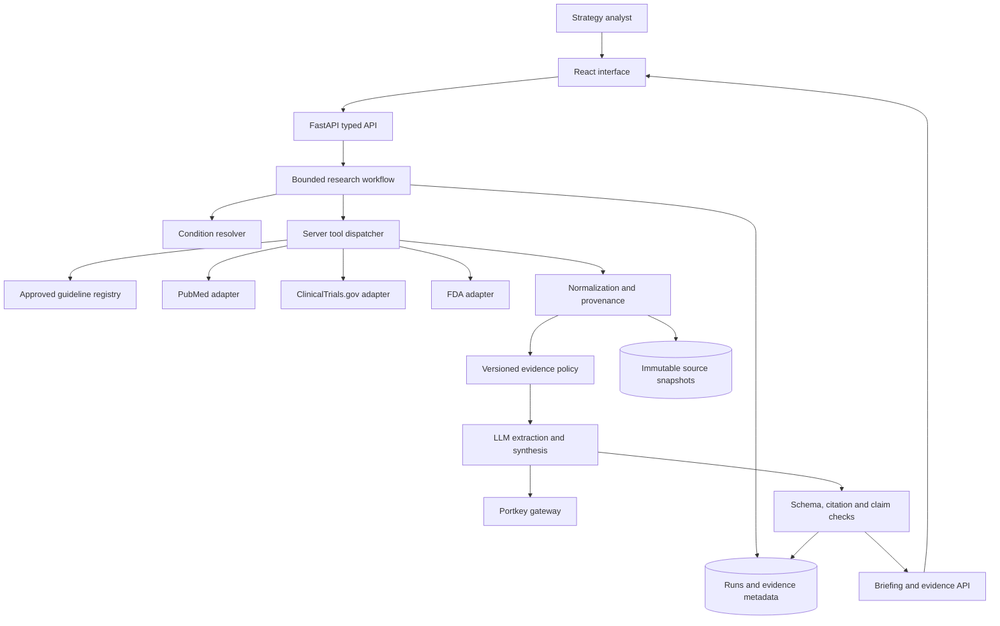
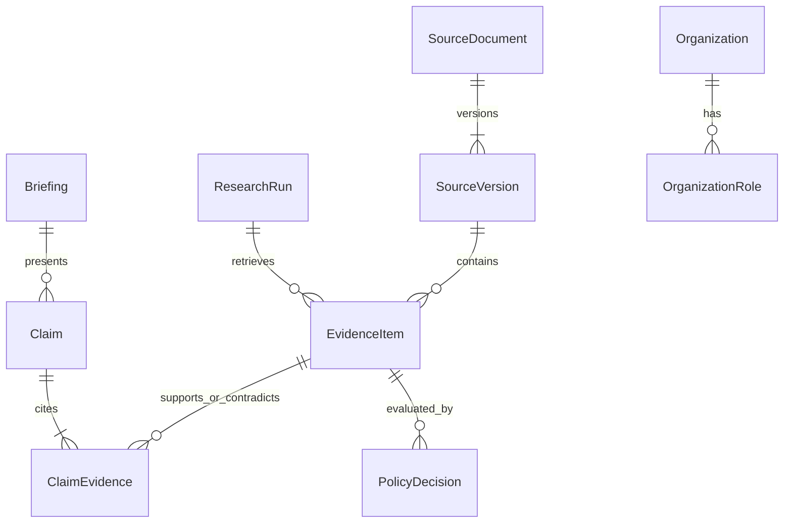

# Architecture Analysis Record

Original engineering analysis captured 2026-10-27. Proposed defaults, limits, schema, stack and delivery estimates are recommendations, not source-established requirements or measured results. This record preserves the authored design used to compile the linked notes. Council results are captured separately and may amend these proposals.

# Healthcare Discovery Summary

## What The Sources Establish

The challenge is to turn a medical condition into a structured briefing for a health system strategy team. The three required output areas are current standard of care, emerging treatments in development, and key companies/institutions. Data must be sourced by the builder. A live local slice is sufficient; cloud deployment is optional. The PDF recommends 120 minutes for the prototype, 10 for a single business slide, and 20 for the interview. The conversation describes two hours plus 30 minutes for Q&A/slide; confirm the exact remaining time before implementation.

Gabriel chose healthcare because of related client experience. His earlier real-estate risk/onboarding example demonstrates experience with full-stack automation, document intake, business rules and feedback; those financial workflows are background, not requirements for this product. The interviewer introduces himself as Dinesh, an AI architect at Insight Global, interviewing for Perficient; these identities are transcript statements, not independently verified facts. Role questions are deferred to Alex in the conversation.

## Ideas Raised And How They Evolved

| Direction | Conversation outcome | Design consequence |
|---|---|---|
| Who uses it | Doctor/patient framing was corrected repeatedly to strategy team | Organizational research workflow; no patient intake or treatment selection |
| Input | Condition name, with fuzzy matching proposed by Gabriel | Resolve term/subtype, then confirm before retrieval |
| Retrieval | Public medical evidence required; synthetic-only cannot demonstrate freshness | Live primary-source queries plus transparently labeled replay |
| Current care | Established treatment landscape | Use current applicable guidelines; an approval alone does not establish care standard |
| Emerging treatments | Trials/publications/regulatory changes | Separate development stage, results availability and approval |
| News | Gabriel proposed 30/60-day discovery | News can surface leads; claims need underlying evidence |
| Pruning/scoring | Interviewer liked the idea, demanded concrete rules | Versioned deterministic eligibility and transparent evidence facets |
| Citation chains | Interviewer warned against treating every layer equally | Resolve underlying evidence; deduplicate families and flag loops |
| Reputation/awards | Proposed initially as trust signals, challenged by interviewer | Exclude popularity, awards and years-in-business from evidence authority |
| LLM council | Proposed to adjudicate contradictory sources | Use here for design; runtime models cannot vote source authority into existence |
| Visualizations/ranking | Accepted only with corrected framing | Compare evidence/development stages, not best treatment for a person |
| Companies | Sponsors/backers and institutions requested | Role-specific, dated evidence links; trial sponsor is not necessarily manufacturer |
| Expert feedback | Interviewer endorsed validating policy with experts | Reviewed policy revisions and evaluation cases; no silent model self-training |
| Omnia/Obsidian | Gabriel explained project memory, transcripts, business/code links and long projects | This vault stores project knowledge; application evidence storage is separate |

The provided transcript stops during vault setup. It contains no completed application, chosen stack, actual clinical evidence policy, measured result, or agreed deployment. Meeting recording/transcription use is permitted in the transcript. Do not infer delivery or results from this.

## Authorization Boundary

The owner's present request is to analyze, consult the council/Claude Code, and write architecture notes. The PDF's build/slide/repository-sharing directions are interview criteria to plan for, not instructions to execute in this turn. No application build, external publication, account access, or message to the interviewer is implied.

See [[Wiki/Concepts/healthcare-product-scope|Product scope]], [[Wiki/Concepts/healthcare-evidence-policy|Evidence policy]], and [[Wiki/Concepts/healthcare-delivery-roadmap|Delivery roadmap]].

# Healthcare Product Scope

## Proposed Product

A condition intelligence workbench that helps health system strategy analysts prepare an auditable care-landscape and innovation briefing. The result supports research triage, service-line planning and conversations about institutions/companies. It makes no claim to choose therapy for an individual.

The minimum input is a condition name. Proposed explicit defaults are US jurisdiction and an as-of time; both remain assumptions until confirmed. Offer subtype/population clarification only when needed. A recent-activity window filters the emerging-evidence view; it does not erase older guidelines that remain current.

## User Flow

1. Enter a condition. Show normalized candidates, synonyms and scope. Ambiguous acronyms require confirmation.
2. Confirm the research scope. Display supported-source coverage before promising a complete briefing.
3. Generate with visible retrieval stages and partial failures.
4. Read an executive summary, current care landscape, emerging pipeline, and companies/institutions.
5. Open any factual claim to inspect its evidence, dates, excerpt, applicability, conflicts and inclusion reason.
6. Filter/sort evidence facets; export a report that retains citations, as-of time, policy version and gaps.

## Acceptance Criteria

| ID | Observable outcome |
|---|---|
| R1 | Condition ambiguity never silently changes the research population |
| R2 | Three required sections exist, or show a specific evidence gap |
| R3 | At least one visibly live primary retrieval is demonstrated |
| R4 | Every rendered factual claim has existing, inspectable evidence references |
| R5 | Rules determine claim eligibility and labels; model agreement cannot override a rejection |
| R6 | Trials, approval and care standards remain distinct; geography is visible |
| R7 | A failed source produces a coverage warning/partial state, never an invented conclusion |
| R8 | Evidence comparison avoids patient-specific treatment recommendations |
| R9 | A recorded replay shows original fetch time and is unmistakable from live mode |

Non-goals for the prototype: EHR integration, patient identifiers, prescribing/dosing, comprehensive coverage of every condition, economic ROI estimates without data, automatic procurement choices, autonomous outreach, model fine-tuning, and production compliance claims.

See [[Wiki/Concepts/healthcare-application-architecture|Architecture]], [[Wiki/Concepts/healthcare-briefing-interface|Interface]], and [[Wiki/Concepts/healthcare-open-questions|Open decisions]].

# Healthcare Application Architecture

## Recommendation And Status

Proposed architecture: a modular monolith with a thin React/TypeScript interface and a typed Python FastAPI backend. Use explicit workflow functions and a small server tool dispatcher. Begin with SQLite plus immutable local evidence snapshots for one local user; migrate to PostgreSQL and object storage before a shared pilot. No application code exists yet. This is a proposal with a staged delivery path, not an implemented system.

Choose a separate application repository, proposed name `healthcare-briefing`, alongside `omnia-vault`. The vault remains the development memory. Runtime evidence, user runs and application credentials never depend on Obsidian or a live vault checkout.

## System Boundaries

The model may request approved supplemental tools through the dispatcher during bounded retrieval. It never chooses its own network destination or edits evidence-policy results. The diagram's policy stage includes metadata screening before model extraction and claim-specific enforcement after extraction.

## Modules And Ownership

| Module | Owns | Must not own |
|---|---|---|
| Interface | Scope confirmation, progress, evidence display, filters | Secrets, evidence authority decisions |
| API | Input validation, run ownership, idempotency, response contracts | Medical truth from JSON validity |
| Workflow | Stage order, deadlines, retries, budgets, partial states | An unbounded autonomous loop |
| Source adapters | Fixed API endpoints, query translation, rate limits | Invented metadata or substituted sources |
| Evidence policy | Claim-type eligibility, labels, exclusions, deterministic ordering | Model-popularity or award-based trust |
| Model adapter | Extraction, bounded tool requests, cited summary | Approval/care-standard adjudication |
| Validators | Structural, reference, quote and semantic-warning checks | A guarantee of scientific correctness |
| Persistence | Source versions, run events, model/policy provenance | Opaque overwrite of prior runs |

## Proposed Stack

- React + TypeScript with Vite: a form, stage display, three evidence sections and a source drawer. Backend serves the built UI under one origin for a simple local/container deployment. SSR adds no demonstrated value here.
- FastAPI + Pydantic: typed input/output, model payload validation and generated API schema. Use Python HTTP clients behind adapters. Explicit Python modules suffice for orchestration initially.
- SQLite/local snapshots for the demo: one process, explicit restart limitations. PostgreSQL/object storage and a durable worker for a shared pilot.
- Portkey through one backend adapter; use the challenge-provided model route when credentials are supplied. Test enterprise authentication, tool calls and structured output before relying on public documentation claims.
- Plain configuration for evidence policy and a small condition/guideline registry. No vector database, graph database, LangChain dependency, separate agent service or Kubernetes in the first slice.

Suggested application layout: `web/`, `api/routes/`, `domain/schemas/`, `domain/policy/`, `workflow/`, `adapters/sources/`, `adapters/llm/`, `persistence/`, `fixtures/`, `evals/`, `docs/`. These are planned paths, not existing files.

## Data Movement And Failures

Persist each normalized source with canonical ID, content hash, retrieval time and locator. Model inputs are evidence IDs plus bounded excerpts; outputs cite IDs. Validate output before rendering; citation failures remove the affected claim, preserving a specific gap. Missing guidelines allow a pipeline-only partial report with the current-care section marked unavailable.

Use server-side read-only source tools. No credentials reach the browser or appear in report exports. Run creation persists scope and policy version before network work. A restart marks interrupted demo runs rather than silently claiming completion. The pilot uses leases/checkpoints and durable queue processing.

## Tradeoffs

Two languages increase setup versus one TypeScript stack. Python is the proposed fit for biomedical parsing, typed data checks and a transparent pipeline, but the team's fastest proven stack should decide if time remaining is very short. Streamlit is the explicit deadline fallback if no React scaffold is ready. n8n can later schedule refreshes; it need not own core evidence rules. A single modular service reduces deployment friction while preserving clear module contracts for later extraction.

See [[Wiki/Concepts/healthcare-api-and-job-flow|API and jobs]], [[Wiki/Concepts/healthcare-data-and-provenance|Data]], [[Wiki/Concepts/healthcare-llm-and-tools|LLM/tools]], [[Wiki/Concepts/healthcare-architecture-decisions|ADRs]], and [[Wiki/Concepts/healthcare-deployment-and-operations|Operations]].

# Healthcare Condition And Source Strategy

## Condition Resolution

Keep raw input, canonical label, terminology identifier when available, aliases, selected subtype/population, jurisdiction and user confirmation. Start with a small curated condition catalog linked to MeSH; fuzzy matching proposes candidates only. Lexical match scores are search aids, not clinical confidence. Unknown or ambiguous terms produce clarification or an explicit unsupported-state response. Do not use an LLM guess to merge distinct conditions.

## Source Plan By Claim Type

| Research need | Proposed source | Permitted inference and limit |
|---|---|---|
| Standard of care | Current authoritative guideline for relevant geography/population | Attribute the recommendation and scope; approval/literature alone cannot substitute |
| Published evidence | PubMed metadata plus accessible abstracts/full text | Indexing is not validation; abstract-only access must be labeled |
| Development pipeline | ClinicalTrials.gov API v2 | Stage, status, sponsor, interventions, dates; registration alone is not benefit |
| Regulatory status | Applicable FDA approval record/label/history for covered products | Exact indication, population and date; not every medical intervention is covered |
| Companies/institutions | Trial sponsor/collaborator data, regulatory applicant, publication affiliations | Evidence supports the specific role only; no inferred ownership or commercial availability |
| Recent discovery | Optional news/press leads | Follow to underlying primary evidence; exclude unsupported promotional claims |

An FDA source is authoritative for the applicable regulatory fact. It does not automatically outrank a well-designed study on every efficacy question, or replace a guideline for care standards. Likewise, a review can contextualize evidence without multiplying the independent trial count.

## Retrieval Boundaries

For the first demo, select one condition with an accessible, date-checked guideline and enough real pipeline data. Type 2 diabetes is a candidate used only for API smoke requests; it has not been accepted as the demo condition or clinically reviewed. Expand to 2–3 supported conditions only after the first complete flow works. Unsupported terms should not trigger a promise of comprehensive research.

Fetch current records, and store both underlying source publication/update dates and the retrieval timestamp. A 30/60-day view is optional for new activity; retrieve established guidelines outside that window. Show query, filters, result caps and sources attempted so users can assess incomplete coverage. Fetching today does not make an old trial record current.

Public smoke requests on 2026-10-27 returned JSON from PubMed ESearch and ClinicalTrials.gov. This proves limited connectivity, not correct clinical retrieval or working application adapters. Guideline discovery/access is the critical unverified dependency; a generic NICE listing returned 403 and UK guidance cannot silently stand in for US care standards.

See [[Wiki/Concepts/healthcare-evidence-policy|Evidence rules]], [[Wiki/Concepts/healthcare-data-and-provenance|Source identity]], and [[Wiki/Concepts/healthcare-evaluation-plan|Evaluation]].

# Healthcare Evidence Policy And Guardrails

## Policy Boundary

Use a versioned, domain-reviewed policy. Deterministic rules enforce known metadata and claim eligibility; LLMs extract relevant passages and propose interpretations. Expert review defines/validates the policy. No model can silently promote a rejected record or invent a guideline. All thresholds below are provisional product engineering choices, not a validated medical grading scheme.

## Hard Gates Before Ordering

1. Validate provenance: allowlisted connector, canonical source identity, source version/snapshot and recoverable locator. An allowlisted domain alone is insufficient.
2. Check condition/subtype/population, jurisdiction, source scope and dates. Uncertain applicability is a visible limitation, not an assumed match.
3. Quarantine retracted/corrected/superseded evidence as applicable to the claim. Missing metadata stays unknown. A withdrawn therapy can still appear as historical context or a safety update with an explicit label.
4. Enforce claim-specific evidence requirements. Standard-care claims require applicable current guideline support; approval claims require the relevant regulatory record; a trial record with no results can support development-stage claims only.
5. Require exact existing evidence IDs and locators for every proposed claim. Check quoted spans against the saved snapshot. News/circular references without recoverable evidence never pass as independent support.

## Show Evidence Facets

Expose source class, study design, phase, status, results availability, population applicability, jurisdiction, guideline currency, regulatory status, access level and conflict flags separately. Store `policy_version`, `decision`, `reason_codes`, `review_needed`, and `evidence_family_id`. Use labels such as eligible/limited/excluded and their reasons; avoid a fake 0–100 truth score.

Default ordering is deterministic within comparable categories: applicability, eligible evidence class for that claim, results availability, then the relevant update/publication date and a stable identifier. Keep regulatory status and trial phase as separate facets rather than collapsing them into one hierarchy. The UI can sort pipeline entries by phase; it must not call the first entry the best therapy. If a weighted research-priority score is later requested, publish the formula, show missing inputs, and obtain domain review before using it.

## Contradictions And Citation Families

Retain contradictory claims with their evidence, dates, population and endpoints. An LLM can flag likely disagreement; distinguish genuine contradiction from different indications or time periods. Do not average incompatible results or let a majority of articles overrule the applicable regulator on approval status. Two articles about one study count as one evidence family. Link systematic reviews to included studies when recoverable; unknown overlap must remain unknown rather than fabricated independence.

Demonstration scenario (synthetic policy fixture): a news article calls a therapy a breakthrough, a registry entry is phase 2 with no results, an applicable FDA search has no verified approval match, and a guideline does not mention it. Output may state the registered investigational study and sponsor, mark efficacy unestablished in retrieved evidence and approval unknown, and exclude it from current-care claims. No search match is not proof of nonapproval. This is a logic fixture, not a claim about any real treatment.

## LLM Guardrails

Treat source text as untrusted data. Policy/schema/reference checks run outside the model. Semantic checking may flag weak support but cannot prove correctness. Unsupported claims are removed or sent to review; do not merely attach a citation to an otherwise unsupported sentence. Model agreement never substitutes for source support or expert judgment.

See [[Wiki/Concepts/healthcare-llm-and-tools|Runtime boundary]], [[Wiki/Concepts/healthcare-security-and-governance|Security]], and [[Wiki/Concepts/healthcare-evaluation-plan|Policy tests]].

# Healthcare LLM And Tool Calling

## Two Separate Councils

The development council compares architectures and exposes dissent. It does not run inside every user research request. The application initially uses one gateway-backed model with a bounded extraction/synthesis workflow. An optional later critic can flag unsupported claims; a second model is advisory, never an authority vote.

## Runtime Responsibilities

The workflow always attempts required supported-condition sources; the model cannot skip the guideline attempt or hide retrieval failures. It may propose a small number of supplemental search queries through typed tools after inspecting the coverage gaps. This satisfies tool calling while keeping control in the server.

| Tool | Input contract | Returns |
|---|---|---|
| `search_trials` | canonical condition ID, bounded query, optional stage/status, capped count | Normalized study records and provenance IDs |
| `search_pubmed` | canonical condition ID, bounded query/date window, capped count | Metadata/excerpts plus access labels |
| `get_guideline` | supported guideline registry ID | Checked document version/sections and limitations |
| `lookup_regulatory_record` | normalized intervention + indication + jurisdiction | Matched record or unknown/ambiguous, never inferred approval |

These are proposed function contracts. The backend maps IDs to fixed endpoints and validates all arguments. Do not expose arbitrary URL fetch, SQL, shell execution, filesystem access, email or deployment tools to the model. Organization links are extracted from typed evidence and role-checked without a broad web crawler in the demo.

## Bounded Sequence

1. Deterministic condition confirmation and source plan.
2. Parallel required-source fetches; metadata screening and snapshots.
3. Optional tool-call round: model proposes gap-filling searches; server validates and executes. Proposed ceiling: two rounds, four supplemental tool calls total.
4. Extract candidate claims/organizations from bounded evidence packets. Model returns source IDs and locators, never arbitrary citation URLs.
5. Apply claim-specific rules, identify duplicates/conflicts, and synthesize only eligible claims into a typed briefing.
6. Validate references and support; allow one bounded repair of schema/reference errors. Drop unresolved claims and show gaps. Stop on deadline/budget; do not loop until the model sounds confident.

Source and token caps are configurable provisional limits: begin with at most 20 candidate records across sources and a small approved guideline excerpt set. Track truncation and relevant evidence omitted. Test the cap on the selected condition rather than claiming it guarantees coverage.

## Gateway Adapter

`generate_structured(schema, evidence_packet, tools, budget)` returns validated data or a typed error, plus model route, prompt version and usage. Backend environment variables hold gateway URL/model/key; no key was supplied in this planning session. First implementation step must verify a real function-tool request/result round trip and structured-output behavior against the supplied enterprise gateway. Public support is insufficient proof of this exact configuration.

If structured output is unavailable, request JSON and validate locally with a bounded repair. If tool calling is unavailable, use a supported route only with authorization or explicitly report the limitation; do not call a deterministic fetch a successful model tool call. Never silently swap providers. Expert feedback changes versioned prompts/policy and evaluation fixtures, not live model weights.

See [[Wiki/Concepts/healthcare-api-and-job-flow|Workflow states]] and [[Wiki/Concepts/healthcare-evidence-policy|Claim controls]].

# Healthcare Data Model And Provenance

## Proposed Core Records

| Record | Important fields |
|---|---|
| `ConditionScope` | raw term, canonical ID/label, aliases, subtype/population, jurisdiction, confirmation |
| `ResearchRun` | run ID, owner, scope, as-of UTC, mode live/replay, state, coverage, policy/prompt/model versions, budgets |
| `SourceDocument` | connector, canonical URL/ID (PMID/DOI/NCT/application), publisher, source type, publication/update/retrieval times |
| `SourceVersion` | document ID, content hash, snapshot URI, parser version, access level, retraction/supersession metadata |
| `EvidenceItem` | source version, evidence family, design/phase/status/results, applicability fields, locator and excerpt |
| `Claim` | typed claim text, subject/intervention, scope, time, status, limitations |
| `ClaimEvidence` | claim ID, evidence ID, relation supports/contradicts/context, locator, verification outcome |
| `Organization` / `OrganizationRole` | normalized name, role sponsor/collaborator/applicant/affiliation, related intervention/study, evidence ID, effective/retrieved dates |
| `PolicyDecision` | record/claim ID, policy version, eligible/limited/excluded, reason codes, reviewer state |
| `Briefing` / `RunEvent` | versioned sections/claim IDs, gaps, conflicts; stage events, tool results, latency and token usage |

Use explicit null/unknown for unavailable facts. Recruitment status is not approval status. Phase is not proof of efficacy. A company name in an affiliation is not a therapy owner. Date-only source fields keep date-only precision; retrieval timestamps use UTC and are displayed in the user's timezone.

## Relationships

The logical model above does not require a graph database. Relational joins and stable IDs provide the first provenance graph. Add a graph index later only if measured relationship queries justify it.

## Snapshot And Deduplication Rules

Preserve original normalized responses and the permitted text used for generation, with hashes and fetch metadata. Store only accessible/licensed text; abstract-only evidence remains labeled. Resolve identity by canonical identifiers and DOI/PMID/NCT links before URL heuristics. Merge evidence-family membership only when provenance supports it. Preserve multiple publications/versions while counting the underlying study once where identifiable.

Historical briefings retain the exact source versions, scope and policy that produced them. Refresh creates a new version; it does not rewrite old evidence. Cache keys include canonical scope, jurisdiction, filters and source/query versions. Cached data display original retrieval time. Policy changes trigger re-evaluation/re-generation rather than relabeling stale output as newly verified.

Application snapshots live in runtime storage, separate from this developer vault's `Raw/Files/`. No database migrations or model contracts have been implemented yet.

See [[Wiki/Concepts/healthcare-evidence-policy|Evidence families]] and [[Wiki/Concepts/healthcare-deployment-and-operations|Storage evolution]].

# Healthcare API And Job Flow

## Proposed API

| Endpoint | Contract |
|---|---|
| `POST /api/conditions/resolve` | Validated condition query -> candidates, ambiguity and supported coverage |
| `POST /api/research-runs` | Confirmed scope, filters, live/replay mode + idempotency key -> 202 and run ID |
| `GET /api/research-runs/{id}` | State, stages, warnings, coverage, budget use and eventual briefing reference |
| `POST /api/research-runs/{id}/cancel` | Request cooperative cancellation; no new work once accepted |
| `GET /api/briefings/{id}` | Typed section/claim/evidence IDs, dates, gaps, conflicts and versions |
| `GET /api/evidence/{id}` | Inspectable source metadata, excerpt/locator, policy reasons and safe canonical link |
| `GET /api/briefings/{id}/export` | Cited JSON/Markdown; polished PDF export deferred |

Pilot endpoints require authenticated run ownership/tenant checks on every ID. Local demo binds to loopback. Poll run status for the prototype; add server-sent events only if polling harms the experience. Server keys and raw internal prompts are never included in public API responses.

## State Machine

`created -> resolving -> fetching -> normalizing -> extracting -> validating -> complete | partial | failed` with `cancelled` and `interrupted` terminal states. Scope is confirmed before creation; resolving checks the canonical scope/registry. Persist stage transitions, source attempts, timestamps and reasons. Do not use a green complete status when essential coverage is missing.

The local demo can use one process and a tracked background coroutine with persisted records. That work is not durable: restart marks active runs interrupted and offers explicit retry/replay. FastAPI BackgroundTasks alone must not be described as reliable distributed job execution. Before a shared pilot, add a separate worker with durable queue/DB job records, leases, bounded retries, checkpoints and idempotent stage writes.

## Budgets And Error Semantics

Initial targets, to validate rather than advertise as measured: about 10 seconds per external source attempt, one retry for transient network/429/5xx only when the overall deadline permits, and a 90-second end-to-end run ceiling. Honor Retry-After; use jitter and a per-provider limiter. Public PubMed access has documented rate limits; multiple workers must share the limit. Cap model requests/tokens and reserve time to validate/render a partial result.

Record source statuses separately: success, no results, timeout, rate-limited, unavailable, unsupported. No-results is not evidence of absence. One failed source need not discard good evidence from another, but missing guidelines prevent a claim of verified current care. A gateway failure may allow a clearly labeled source-only results view, never a fabricated generated briefing.

Idempotency binds the same creation key to the same caller and scope. Concurrent retries must not duplicate a run. Tool-call IDs and source-write keys prevent duplicates; cancellation/deadline checks occur between awaits/stages. Never retry permanent auth/schema/policy errors indefinitely.

See [[Wiki/Concepts/healthcare-application-architecture|Modules]] and [[Wiki/Concepts/healthcare-evaluation-plan|Failure tests]].

# Healthcare Briefing Interface

## Proposed Screen

A single workbench begins with a condition input and candidate confirmation. The scope line always displays condition/subtype, jurisdiction, as-of date, live/replay mode and evidence coverage. Run progress shows actual source attempts, not simulated animation.

The completed briefing contains an executive summary and three core sections: current care landscape, emerging pipeline, and companies/institutions. Each section exposes evidence gaps even when another section succeeds. The executive summary is derived from validated claims and preserves their citations.

## Useful Visuals

- A pipeline table/timeline: intervention, phase, status, results availability, sponsor, last source update, evidence link. Phase labels and unknowns are explicit.
- An evidence comparison table: source class, applicability, publication/update dates, access level, policy reasons and conflict flags. Sort within a meaningful category; do not display a universal best-treatment leaderboard.
- A company/institution view: role-specific relationships to trials/interventions. Counts represent retrieved evidence, not market share or innovation performance.

Start with tables because they expose the required distinctions and are quick to ship. Add charts only when they answer a concrete strategy question. A missing result is not zero; inaccessible evidence is not a negative finding. Do not compare efficacy across studies with different populations/endpoints as though it were a controlled comparison.

## Evidence Drawer

Click a claim citation to see the source title/identifier, canonical URL, publication/update/retrieval dates, exact excerpt and section/JSON locator, applicability, source access level, evidence family, policy version and inclusion/exclusion reasons. Mark conflicting sources and show both accounts. Render source text as escaped text; do not trust external HTML.

Empty and partial states should say what could not be retrieved and what the analyst can do next. Unsupported conditions receive a specific explanation and supported candidates. Replay retains the original fetch timestamp in the header and export. Provide a concise strategy-use scope statement in the report; avoid cluttering each user action with engineering details.

See [[Wiki/Concepts/healthcare-product-scope|User acceptance]] and [[Wiki/Concepts/healthcare-data-and-provenance|Evidence fields]].

# Healthcare Security And Governance

## Research Boundary

The intended input is a condition, not patient data. Keep patient identifiers, EHR access, prescribing and clinical treatment decisions outside the prototype. Reject or ask users to remove accidental personal case material; a text filter is not proof that all sensitive input can be detected. Do not claim HIPAA readiness or regulatory clearance from this architecture.

## Trust Boundaries

All external source text is untrusted. It is quoted data for extraction, never authority to change instructions, tool permissions, policy, or secrets. Model output is also untrusted until validation. Use fixed source connectors and a server-side tool allowlist; the model receives no shell/browser/network credentials.

Avoid general URL fetching in the demo. If later needed, validate HTTPS scheme, exact allowed host/path, DNS-resolved public IPs, redirect destinations, size/content-type limits and timeouts; block private, loopback and cloud metadata addresses at every hop. An allowlist in the prompt is not SSRF enforcement. Test DNS/redirect behavior, and keep outbound network policy separate from LLM reasoning.

Escape source excerpts; sanitize Markdown and external links; reject executable HTML. Keys stay in server environment/secret manager and never enter the browser bundle, prompts, screenshots, snapshots or git. Logs retain IDs, timings and reason codes with content redaction; full prompt/response capture is restricted and governed by retention policy.

## Pilot Governance

Add identity-provider login, role/run/tenant authorization, secure sessions, request limits, encrypted storage/transport, backup/restore and deletion/retention controls before sharing with a team. Audit events record policy/model/prompt versions and reviewer changes. Domain reviewers approve evidence-policy versions and supported guideline mappings. A reviewer override is attributed and explained; it never rewrites the historic source.

Agree source-use permissions before storing/re-exporting substantial text; PubMed abstracts and linked full text can have different rights. Prefer identifiers, metadata and short permitted excerpts when rights are unclear. Expert feedback becomes reviewed policy/prompt changes plus regression cases, not hidden online learning.

The development council record is decision support. Its existence is not security certification or medical validation. This vault's original attachments are local and gitignored; compiled notes and derived captures are committed locally. The template remote must not receive project material.

See [[Wiki/Concepts/healthcare-llm-and-tools|Server tool boundary]] and [[Wiki/Concepts/healthcare-deployment-and-operations|Pilot operations]].

# Healthcare Evaluation Plan

## What Correctness Means

Evaluate source retrieval, claim support, policy decisions and user interpretation separately. A well-formed response and a real citation do not prove the sentence follows from the evidence. Model agreement is not a ground-truth label. A domain reviewer must assess the supported condition's guideline mapping and representative clinical statements before real strategy reliance.

## Proposed Test Set

| Case | Expected observable behavior |
|---|---|
| Valid supported condition | Three sections populated or explicitly gapped; claim citations inspectable |
| Ambiguous acronym/subtype | User confirmation before research |
| Unsupported condition | Honest unsupported/limited coverage state |
| Registry record without results | Pipeline description only; no efficacy inference |
| Generic label listing without approval proof | Regulatory status unknown; no invented approval |
| Review plus three news copies of one trial | One evidence family when lineage can be verified |
| Circular citation with no primary record | Exclude as independent support; show reason |
| New press item conflicts with guideline | Keep dates/scope/conflict; no automatic guideline replacement |
| Abstract-only or paywalled source | Access level visible; no claim about unseen full text |
| Corrected/retracted/superseded source | Applicable policy flag/exclusion; no quiet reuse |
| Source outage/429/gateway failure | Bounded timeout and partial/source-only view with warning |
| Invented evidence ID or false quote | Claim rejected or one repair; never render as verified |
| Prompt injection in source | Cannot change tool permissions, policy or report instructions |
| Private-address URL/redirect | No fetch; typed rejection |
| Restart/cancel/duplicate request | Interrupted/cancelled or same idempotent run; no false complete |
| Replay fixture | Original retrieval time and replay label persist through export |

Use deterministic sanitized fixtures for edge cases and a small live smoke suite for adapter availability. Keep synthetic policy fixtures labeled. Version reviewer-labeled cases; record disagreement rather than treating majority model votes as truth. Tests should target consequential behavior rather than mirror implementation internals.

## Release Gates And Measurements

Prototype gate: demonstrate one supported-condition live path, one contradiction/eligibility example and one source failure/replay case. All rendered factual claims have valid evidence IDs/locators; no known unsupported clinical statement is accepted in the reviewed demo set. This is a release criterion, not an achieved result.

Pilot measurements: reviewer-labeled claim support precision, citation/reference validity, retrieval relevance on a curated set, current-care guideline applicability, company-role accuracy, duplicate-family errors, conflict detection, abstention correctness, latency percentiles, cost per run, provider failure rate and user time to a usable briefing. Set numerical quality targets with the domain reviewer after a baseline; do not invent 95% accuracy or ROI.

Log result caps and sources attempted. A finite test set cannot establish comprehensive literature coverage or clinical safety. User feedback and new failure cases trigger policy/prompt revisions and reruns of meaningful regression cases.

See [[Wiki/Concepts/healthcare-product-scope|Acceptance criteria]] and [[Wiki/Concepts/healthcare-delivery-roadmap|Demo sequence]].

# Healthcare Deployment And Operations

## Local Prototype

Build the React UI and serve static assets with FastAPI under one origin; use one backend process, SQLite and a local snapshot directory. During development Vite may run separately with an API proxy. Bind the demo to loopback, load model credentials from an untracked environment file, and provide a startup check for gateway/source availability. Store exact dependency versions in a lockfile during implementation; no versions are selected merely from memory in this plan.

A local request background task is interruptible by process restart. Persist run metadata and mark active runs interrupted on boot. Provide a cached/replay evidence fixture clearly labeled with fetch time. No cache or fixture is described as a fresh live retrieval.

## Optional Hosted Demo

A single container can serve the API and built UI. Add a health endpoint, server-side secret injection, HTTPS, access restriction, request caps, and persistent storage suitable for the deployment platform. Never place SQLite on an ephemeral filesystem and call the history durable. Cloud hosting is a bonus only after the core live demo works; it is not authorized to execute in this planning turn.

## Shared Pilot

Move metadata to PostgreSQL and snapshots to object storage. Keep the modular API and add a durable worker/queue or DB-backed job leasing with checkpoints. Introduce migrations, immutable source versions, tenant/run authorization, backups and tested restore, retention controls and safe deployment rollback. Use job IDs to join traces across API, worker, tools, model and report. A pilot worker cannot rely on an HTTP process remaining alive.

Version prompts, policies, parsers and model routes alongside each run. Monitor source availability, freshness/coverage gaps, unsupported claims rejected, review backlog, rate-limit errors, p50/p95 completion time and actual model usage/cost. Budgets and dollar costs depend on the supplied gateway configuration and are unmeasured. Separate stale-source age from recent retrieval time in monitoring.

Refresh scheduling is a later feature; n8n could trigger server APIs when needed. Do not build an ingestion platform, vector service or autonomous crawler until measured usage supports it. Store observability content sparingly and redact secrets/accidental personal data.

See [[Wiki/Concepts/healthcare-api-and-job-flow|Run durability]] and [[Wiki/Concepts/healthcare-security-and-governance|Security requirements]].

# Healthcare Delivery Roadmap

## Proposed 120-Minute Build Slice

This is an implementation plan for the interview constraint, not a record of elapsed work or a promise that planning has left the full window available. Reassess time remaining before starting. Reserve the separate slide/Q&A time described by the sources.

| Minutes | Deliverable | Cut if behind |
|---|---|---|
| 0–10 | Confirm one supported condition/jurisdiction; validate gateway auth, real tool-call round trip and output schema; choose accessible guideline | Change supported condition if guideline unavailable; disclose gateway limits |
| 10–30 | Source adapters for checked guideline, ClinicalTrials.gov and PubMed; save provenance and one replay fixture | FDA live adapter can defer, with approval status unknown |
| 30–50 | Typed records, deduplication and deterministic eligibility/reason codes | Use facets, no numeric scoring or complex graph |
| 50–75 | Bounded model extraction/tool dispatch and cited synthesis; reference checks and partial outputs | Omit optional critic/council runtime |
| 75–95 | Minimal interface: condition, progress, three sections, evidence drawer and tables | Use Streamlit if no working React scaffold; drop chart polish |
| 95–110 | Verify supported case, ambiguity, unsupported claim and source-failure behavior | Focus consequential checks and truthful limitations |
| 110–120 | Demo rehearsal, README/setup, sanitized fixtures and known gaps; prepare repository contents | Skip cloud deployment |

If actual remaining time is substantially shorter, deliver one cited vertical slice with transparent gaps and a Streamlit interface rather than claiming all capabilities are complete. Local deployment meets the transcript's minimum. Prioritize actual model tool calling, real retrieval and visible policy over decorative architecture.

## Demo Narrative And Slide Plan

Walk through the strategy analyst's condition input, ambiguity confirmation, live source retrieval, three-section briefing, one evidence drawer, a trial-without-results guardrail and a partial-source failure. Show source dates and research gaps. Explain deterministic evidence eligibility versus model summarization in plain language.

Plan one stakeholder slide: who needs this and the current manual research burden; how one condition becomes a cited care/pipeline/company briefing; why visible evidence/gaps improve review; what the prototype demonstrates; next validation step. Do not claim quantified time savings, clinical outcomes or ROI without measurement. A slide file is not created by this architecture task.

Repository handoff plan: application code, clear startup instructions, environment variable names without values, architecture/limitations, meaningful checks and permitted small fixtures. The interview requests a repository link and optionally AI chats. Actual sharing/pushing requires the owner's instruction and a destination; never push to the Omnia template origin. Redact secrets, account details, private material and machine paths from any future chat export.

## Beyond The Interview

1. Review policy/guideline mappings with a domain expert and establish a labeled evaluation baseline.
2. Add pilot identity, durable jobs, PostgreSQL/object storage, monitoring and evidence/source-use governance.
3. Expand condition/jurisdiction coverage with checked source registries and measured retrieval quality.
4. Add report comparison, evidence-change tracking, saved research and optional advisory critic only when users need them.

See [[Wiki/Concepts/healthcare-open-questions|Open decisions]] and [[Wiki/Concepts/healthcare-evaluation-plan|Release gates]].

# Healthcare Architecture Decisions

## ADR-001: Explicit Workflow With Deterministic Evidence Policy

**Status:** Proposed. **Date:** 2026-10-27. **Deciders:** Owner; domain reviewer validates evidence policy before pilot reliance.

**Context:** The strategy briefing needs live sources, transparent trust logic and a demonstrable slice in roughly two hours. The interviewer explicitly challenges model-voted authority and treatment recommendations.

**Decision:** Use deterministic source/claim eligibility, independent evidence facets, bounded model extraction/tool requests and cited synthesis. Use the LLM council for development decisions. Defer a runtime multi-model critic until evaluation proves benefit.

**Options:** A model-led autonomous council offers breadth but adds cost, latency, opaque agreement and difficult debugging. A rules-only extractor is reproducible but weaker for concise synthesis. The proposed hybrid preserves explainable control and uses models for text work.

**Consequences:** Evidence policy and supported guideline mappings require expert validation. The system can abstain and expose gaps. It must not market a facet ordering as medical certainty. Reopen if labeled evaluation shows an advisory critic materially catches unsupported claims within the budget.

## ADR-002: Modular Python API And Thin React UI

**Status:** Proposed. **Date:** 2026-10-27. **Decider:** Owner.

**Decision:** FastAPI/Pydantic plus React/TypeScript; SQLite and snapshots for local demonstration, PostgreSQL/object storage/durable worker for pilot. Use one application deployment boundary initially.

| Option | Complexity | Main strength | Main cost |
|---|---|---|---|
| FastAPI + React | Moderate | Explicit typed data pipeline and flexible evidence UI | Two-language setup |
| One TypeScript full-stack service | Moderate | One language and potentially faster familiar scaffold | Less advantage if Python is the established retrieval toolset |
| Streamlit | Low | Fastest fallback to a working end-to-end slice | Less UI control and later frontend migration |
| n8n as core | Low initial, rising with complex policy | Provided environment and visible wiring | Evidence contracts/tests/versioning harder to keep in one place |
| Multi-service autonomous agents | High | Independent runtime roles | Unjustified setup and operational burden for this slice |

**Consequences:** Choose the fastest already-proven scaffold when the actual build begins. No evidence in the transcript establishes the team's relative framework speed, so the preferred stack remains a recommendation. Reopen if setup consumes the retrieval/demo budget or existing client infrastructure requires another platform.

## ADR-003: Supported Conditions Before Universal Coverage

**Status:** Proposed. **Date:** 2026-10-27. **Decider:** Owner with domain reviewer.

**Decision:** Start with one condition and an explicitly checked applicable guideline. Use live public trial/publication queries and expose unavailable sections. Expand only with tested source coverage.

**Tradeoff:** Less breadth in the demo, stronger honesty about care-standard support. Generic search across arbitrary diseases would increase recall but does not establish accessible, current, applicable guideline evidence. Reopen after a reviewed condition catalog and source-coverage tests exist.

## Follow-up

- [ ] Confirm the preferred stack against actual remaining interview time.
- [ ] Select a condition, geography, guideline and reviewer.
- [ ] Verify the enterprise gateway's real tool/structured-output path.
- [ ] Resolve the council's surviving dissent and record any owner changes.

See [[Wiki/Concepts/healthcare-council-verdict|Council record]] and [[Wiki/Concepts/healthcare-application-architecture|Full design]].

# Healthcare Open Questions

## Decisions Still Open

| Question | Working recommendation | Why it matters |
|---|---|---|
| Actual time remaining? | Re-budget the 120-minute plan before build | The transcript is not a live timer |
| First condition and subtype? | One well-covered supported condition | Determines guideline availability and test cases |
| Jurisdiction? | Explicit US assumption for prototype | FDA status and UK guidelines cannot silently mix |
| Applicable current guideline and access rights? | Manually checked source registry entry | Critical dependency for standard-care section |
| Who validates policy and claims? | Named domain reviewer from client team | Engineering facets are not clinical grading |
| Enterprise gateway credentials/capabilities? | Backend-only adapter and startup capability probe | Public docs do not prove provided route works |
| Fastest proven scaffold? | FastAPI/React preferred; Streamlit deadline fallback | No transcript evidence establishes framework speed |
| Auth/tenant/retention requirements? | Local single-user demo, define before pilot | Changes access/storage/operations requirements |
| Budget, run targets and refresh schedule? | Bounded configurable requests; measure first | No reliable cost/latency baseline yet |
| Which organizations and roles matter? | Sponsor/collaborator/applicant/affiliation separately | Ownership and commercial claims need additional evidence |
| Repository sharing destination? | Separate application repository later | Template origin must not receive project material |
| Should future chats be shared? | Only with explicit scope and redaction | Optional in transcript; not authorized now |

These questions do not block the present strategy and notes. They block unsupported claims of production readiness or comprehensive medical coverage. Proposed defaults are not client agreements.

## Evidence That Reopens The Architecture

- Guideline access fails for the chosen condition -> change the supported demo condition or mark current-care coverage unavailable.
- Gateway lacks required tool/structured-output support -> adapt transparently or request an approved route; never simulate success.
- Labeled evaluation shows unsupported claims persist -> strengthen abstention and review before expanding coverage.
- Pilot concurrency/restart requirements arrive -> adopt durable jobs and shared storage before launch.
- Measured setup time exceeds the demo budget -> use the fastest complete vertical slice and record the stack change.

See [[Wiki/Projects/healthcare-system|Project hub]] and [[Wiki/Concepts/healthcare-architecture-decisions|Proposed decisions]].
