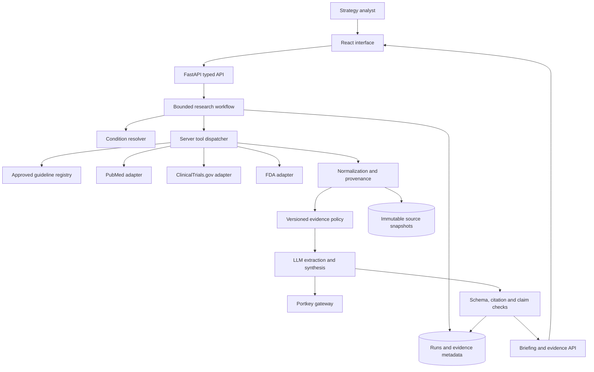

---
tags:
  - "concept"
topics:
  - "healthcare-system"
status: growing
created: 2026-10-27
updated: 2026-10-27
sources:
  - Raw/Sources/2026-10-27-architecture-analysis.md
  - Raw/Sources/2026-10-27-discovery-transcript.md
  - Raw/Sources/2026-10-27-prototype-challenge.md
  - Raw/Sources/2026-10-27-architecture-research.md
  - Raw/Sources/2026-10-27-healthcare-architecture-council.md
  - Raw/Sources/2026-10-27-evidence-runtime-request.md
  - Raw/Sources/2026-10-27-evidence-runtime-implementation.md
  - Raw/Sources/2026-10-27-evidence-runtime-handoff.md
source_count: 8
aliases: []
---

# Healthcare Application Architecture

> [!info] Implemented slice — 2026-10-27
> React/TypeScript, FastAPI/Pydantic, PostgreSQL and Docker are now implemented. The owner explicitly requires PostgreSQL, replacing the earlier SQLite demo proposal below. OpenAI/NCBI credentials work, with a configurable `gpt-4.1-mini` default. The sourcing-to-evidence processing seam, citation identity/ranking, claim-source links, potential conflicts and cited exports are tested. The earlier recommendation remains design history; use [[Wiki/Concepts/healthcare-evidence-runtime]] for actual behavior and remaining guideline/FDA/production gaps.

> [!info] Source and decision status
> The interview and PDF establish requirements; the authored design and researched documentation support the proposals. Technical choices remain proposed until adopted.

## Recommendation And Status

Proposed architecture: a modular monolith with a thin React/TypeScript interface and a typed Python FastAPI backend. Use explicit workflow functions and a small server tool dispatcher. Begin with SQLite plus immutable local evidence snapshots for one local user; migrate to PostgreSQL and object storage before a shared pilot. No application code exists yet. This is a proposal with a staged delivery path, not an implemented system.

Choose a separate application repository, proposed name `healthcare-briefing`, alongside `omnia-vault`. The vault remains the development memory. Runtime evidence, user runs and application credentials never depend on Obsidian or a live vault checkout.

## System Boundaries

The model may request approved supplemental tools through the dispatcher during bounded retrieval. It never chooses its own network destination or edits evidence-policy results. The diagram's policy stage includes metadata screening before model extraction and claim-specific enforcement after extraction.

## Modules And Ownership

| Module | Owns | Must not own |
|---|---|---|
| Interface | Scope confirmation, progress, evidence display, filters | Secrets, evidence authority decisions |
| API | Input validation, run ownership, idempotency, response contracts | Medical truth from JSON validity |
| Workflow | Stage order, deadlines, retries, budgets, partial states | An unbounded autonomous loop |
| Source adapters | Fixed API endpoints, query translation, rate limits | Invented metadata or substituted sources |
| Evidence policy | Claim-type eligibility, labels, exclusions, deterministic ordering | Model-popularity or award-based trust |
| Model adapter | Extraction, bounded tool requests, cited summary | Approval/care-standard adjudication |
| Validators | Structural, reference, quote and semantic-warning checks | A guarantee of scientific correctness |
| Persistence | Source versions, run events, model/policy provenance | Opaque overwrite of prior runs |

## Proposed Stack

- React + TypeScript with Vite: a form, stage display, three evidence sections and a source drawer. Backend serves the built UI under one origin for a simple local/container deployment. SSR adds no demonstrated value here.
- FastAPI + Pydantic: typed input/output, model payload validation and generated API schema. Use Python HTTP clients behind adapters. Explicit Python modules suffice for orchestration initially.
- SQLite/local snapshots for the demo: one process, explicit restart limitations. PostgreSQL/object storage and a durable worker for a shared pilot.
- Portkey through one backend adapter; use the challenge-provided model route when credentials are supplied. Test enterprise authentication, tool calls and structured output before relying on public documentation claims.
- Plain configuration for evidence policy and a small condition/guideline registry. No vector database, graph database, LangChain dependency, separate agent service or Kubernetes in the first slice.

Suggested application layout: `web/`, `api/routes/`, `domain/schemas/`, `domain/policy/`, `workflow/`, `adapters/sources/`, `adapters/llm/`, `persistence/`, `fixtures/`, `evals/`, `docs/`. These are planned paths, not existing files.

## Data Movement And Failures

Persist each normalized source with canonical ID, content hash, retrieval time and locator. Model inputs are evidence IDs plus bounded excerpts; outputs cite IDs. Validate output before rendering; citation failures remove the affected claim, preserving a specific gap. Missing guidelines allow a pipeline-only partial report with the current-care section marked unavailable.

Use server-side read-only source tools. No credentials reach the browser or appear in report exports. Run creation persists scope and policy version before network work. A restart marks interrupted demo runs rather than silently claiming completion. The pilot uses leases/checkpoints and durable queue processing.

## Tradeoffs

Two languages increase setup versus one TypeScript stack. Python is the proposed fit for biomedical parsing, typed data checks and a transparent pipeline, but the team's fastest proven stack should decide if time remaining is very short. Streamlit is the explicit deadline fallback if no React scaffold is ready. n8n can later schedule refreshes; it need not own core evidence rules. A single modular service reduces deployment friction while preserving clear module contracts for later extraction.

See [[Wiki/Concepts/healthcare-api-and-job-flow|API and jobs]], [[Wiki/Concepts/healthcare-data-and-provenance|Data]], [[Wiki/Concepts/healthcare-llm-and-tools|LLM/tools]], [[Wiki/Concepts/healthcare-architecture-decisions|ADRs]], and [[Wiki/Concepts/healthcare-deployment-and-operations|Operations]].

> [!note] Council amendment
> The available council favors a Streamlit shell for a strict two-hour demo without a proven scaffold. FastAPI/React is the proposed target product; keep domain contracts reusable. The outsider favors a single TypeScript service. Claude seats/review are pending authentication, so this is not cross-model consensus. See [[Wiki/Concepts/healthcare-council-verdict]].
