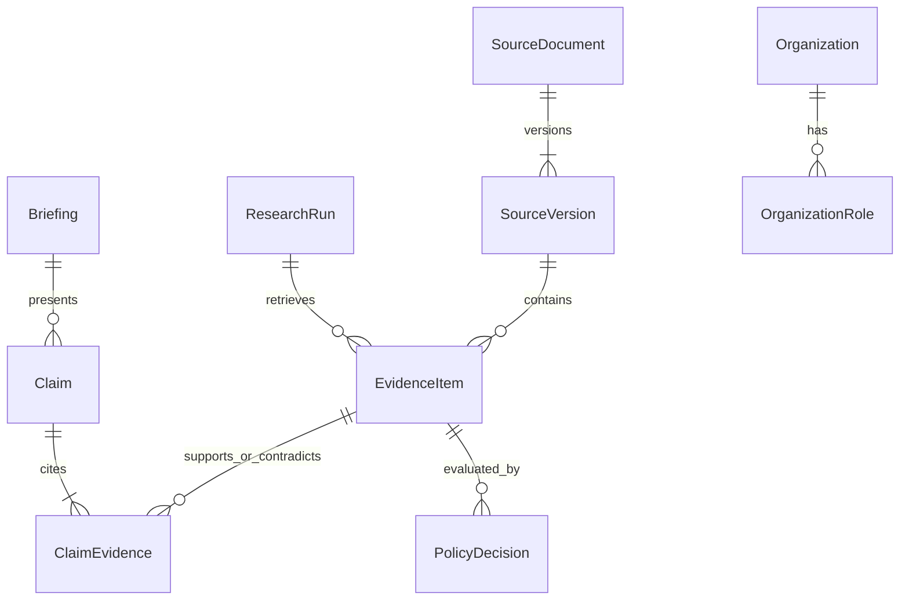

---
tags:
  - "concept"
topics:
  - "healthcare-system"
status: growing
created: 2026-10-27
updated: 2026-10-27
sources:
  - Raw/Sources/2026-10-27-architecture-analysis.md
  - Raw/Sources/2026-10-27-discovery-transcript.md
  - Raw/Sources/2026-10-27-prototype-challenge.md
  - Raw/Sources/2026-10-27-architecture-research.md
source_count: 4
aliases: []
---

# Healthcare Data Model And Provenance

> [!info] Source and decision status
> The interview and PDF establish requirements; the authored design and researched documentation support the proposals. Technical choices remain proposed until adopted.

## Proposed Core Records

| Record | Important fields |
|---|---|
| `ConditionScope` | raw term, canonical ID/label, aliases, subtype/population, jurisdiction, confirmation |
| `ResearchRun` | run ID, owner, scope, as-of UTC, mode live/replay, state, coverage, policy/prompt/model versions, budgets |
| `SourceDocument` | connector, canonical URL/ID (PMID/DOI/NCT/application), publisher, source type, publication/update/retrieval times |
| `SourceVersion` | document ID, content hash, snapshot URI, parser version, access level, retraction/supersession metadata |
| `EvidenceItem` | source version, evidence family, design/phase/status/results, applicability fields, locator and excerpt |
| `Claim` | typed claim text, subject/intervention, scope, time, status, limitations |
| `ClaimEvidence` | claim ID, evidence ID, relation supports/contradicts/context, locator, verification outcome |
| `Organization` / `OrganizationRole` | normalized name, role sponsor/collaborator/applicant/affiliation, related intervention/study, evidence ID, effective/retrieved dates |
| `PolicyDecision` | record/claim ID, policy version, eligible/limited/excluded, reason codes, reviewer state |
| `Briefing` / `RunEvent` | versioned sections/claim IDs, gaps, conflicts; stage events, tool results, latency and token usage |

Use explicit null/unknown for unavailable facts. Recruitment status is not approval status. Phase is not proof of efficacy. A company name in an affiliation is not a therapy owner. Date-only source fields keep date-only precision; retrieval timestamps use UTC and are displayed in the user's timezone.

## Relationships

The logical model above does not require a graph database. Relational joins and stable IDs provide the first provenance graph. Add a graph index later only if measured relationship queries justify it.

## Snapshot And Deduplication Rules

Preserve original normalized responses and the permitted text used for generation, with hashes and fetch metadata. Store only accessible/licensed text; abstract-only evidence remains labeled. Resolve identity by canonical identifiers and DOI/PMID/NCT links before URL heuristics. Merge evidence-family membership only when provenance supports it. Preserve multiple publications/versions while counting the underlying study once where identifiable.

Historical briefings retain the exact source versions, scope and policy that produced them. Refresh creates a new version; it does not rewrite old evidence. Cache keys include canonical scope, jurisdiction, filters and source/query versions. Cached data display original retrieval time. Policy changes trigger re-evaluation/re-generation rather than relabeling stale output as newly verified.

Application snapshots live in runtime storage, separate from this developer vault's `Raw/Files/`. No database migrations or model contracts have been implemented yet.

See [[Wiki/Concepts/healthcare-evidence-policy|Evidence families]] and [[Wiki/Concepts/healthcare-deployment-and-operations|Storage evolution]].
