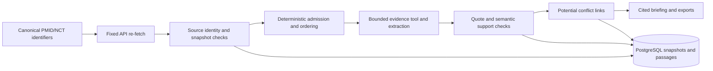

---
tags:
  - "concept"
topics:
  - "healthcare-system"
status: growing
created: 2026-10-27
updated: 2026-10-27
sources:
  - Raw/Sources/2026-10-27-evidence-runtime-request.md
  - Raw/Sources/2026-10-27-evidence-runtime-implementation.md
  - Raw/Sources/2026-10-27-sourcing-discovery-transcript.md
  - Raw/Sources/2026-10-27-evidence-runtime-handoff.md
  - Raw/Sources/2026-10-27-evidence-scope-trace.md
source_count: 5
aliases: []
---

# Healthcare Evidence Runtime

> [!info] Current correction
> Policy v3 is implemented, locally deployed and verified. [[Wiki/Concepts/healthcare-evidence-scope-trace|The source-version trace]] supersedes the earlier concurrent-work notice and records the final run. Baseline v2 counts below are historical verification, not current coverage.

The implemented layer after sourcing authenticates source identity, ranks citations under fixed policy, links claims to saved passages, and preserves potential conflicting findings. It is available through the local Evidence Desk application at [localhost:5173](http://localhost:5173), with API documentation at [localhost:8000/docs](http://localhost:8000/docs).

## Implemented Flow

`backend/app/policy.py` owns policy version `us-evidence-2026-10-27.v3`. Condition/subtype, primary focus, population and trial-activity gates precede ordering by evidence class, results, dates and stable IDs. Specific populations have a separate section; historical/unverified trial records stay inspectable without current claims. It does not score clinical truth or patient suitability. Retractions and identity mismatches are excluded; limitations remain explicit.

`backend/app/workflow.py` connects claims to evidence IDs and quotations. `backend/app/database.py` stores runs, immutable snapshots, citations, passages, claims, claim-evidence links, conflicts and events in PostgreSQL. Source text is untrusted data. No model can modify source authority, execute arbitrary fetches or bypass a failed gate.

## Integration Contract

The implemented upstream seam is `POST /api/evidence/process`, returning 202 and a run ID. Required fields include a condition and `scope_confirmed: true`; optional source lists are `pmids` and `nct_ids`, with US/live scope. At least one identifier is required. The service re-fetches IDs rather than trusting caller-provided text or verification flags. `POST /api/research-runs` adds its own bounded PubMed/trial discovery before the same pipeline.

Poll `GET /api/research-runs/{id}`. Inspect `GET /api/citations/{id}` and `/snapshot`. Export `/api/research-runs/{id}/export?format=markdown|json`. The report retains its run policy version, dates, scope, gaps, original evidence references and content hashes. Keys remain in the ignored backend environment; the optional application token is separate.

## Conflicting Citations

Accepted claims with explicit matching intervention/population/outcome and opposing findings create a potential conflict. Both claims and citations remain visible and unresolved. An analyst compares study design, comparator, dates and applicability. The system does not average contradictory findings or use model votes to choose a winner. Exact matching can miss differently worded conflicts, so no detected conflict is not consensus.

## Verified Local Slice

The policy-v2 type 2 diabetes example retrieves eight records, stores ten accepted/structured claims, and withholds three candidates. The model makes one actual allowlisted evidence-tool call across three requests. Twenty backend tests pass using actual PostgreSQL; production frontend/Docker builds and desktop/mobile browser checks pass. These are implementation observations, not clinical validation. See the source implementation record for the specific run ID and check details.

Run from the backend repository with `docker compose up -d --build`. Compose runs API, frontend and PostgreSQL locally; database data persists in a named volume. Backend tests: `uv run pytest -q`; actual running-service smoke: `uv run python scripts/smoke_http.py`.

## Remaining Boundaries

No checked current US guideline or FDA connector is wired. Current standard of care and approval claims are withheld, rather than inferred from PubMed indexing or registry presence. PubMed abstracts do not establish full-paper review. Automated semantic checking is probabilistic and expert appraisal remains necessary. Prototype jobs are single-process and become interrupted on restart; production identity/tenants, durable workers and migrations are future pilot work.

See [[Wiki/Concepts/healthcare-evidence-policy|Evidence policy]], [[Wiki/Concepts/healthcare-sourcing-contract|Sourcing contract]], [[Wiki/Concepts/healthcare-data-and-provenance|Provenance design]], and [[Wiki/Projects/healthcare-system|Project hub]].
